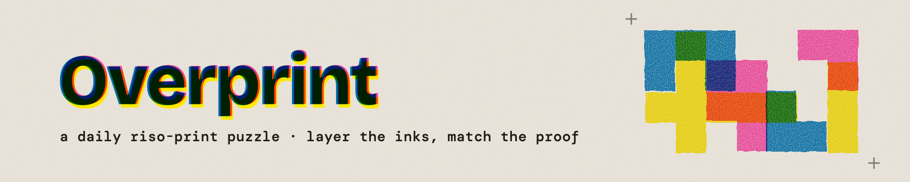

# Overprint

**A daily riso-print puzzle for Reddit.** Layer coloured ink stamps so their overlaps recreate
today's print. Built on Devvit Web for Reddit's Game of the Day hackathon.



## How to play

1. **Tap a stamp** in the tray to pick it up. (Tap **Rotate** to turn it.)
2. **Tap the paper.** A ghost shows where it will land. **Tap the same square again** (or **Stamp**)
   to press it down.
3. **Match the proof.** Make your paper look exactly like the small "proof" card. Tap a printed
   stamp to lift it back up.

Every stamp has a fixed shape and a fixed ink. Inks are see-through, like a risograph, so
overlaps mix:

| Inks | Result |
|---|---|
| 🟦 blue + 🟨 yellow | 🟩 green |
| 🟥 pink + 🟨 yellow | 🟧 orange |
| 🟦 blue + 🟥 pink | 🟪 purple |
| all three | 🟫 ink black |
| the same ink twice | no change |

**Scoring:** time from your first pick-up, plus **lifts** (each lift or undo). Leaderboard score =
time + 10 s per lift. Solve with zero lifts for a **✦ clean print**.

The interaction is tap-only: no dragging, swiping or long-presses anywhere.

## The daily loop

- **One print a day, the same for everyone.** Every day at 00:00 UTC a scheduler job posts
  "Overprint #N · Mon 1 Dec". The puzzle is generated deterministically from the date, so it's
  the same on every device.
- **Difficulty follows the week:** Monday is a 5×5 sheet with two stamps. Saturday and Sunday are
  7×7 with five stamps plus one decoy.
- **In the feed**, the post shows today's proof, how many people have printed it, your streak and a
  **Play** button. It renders straight from the post data, so it doesn't wait on the network.
- **Result card:** your time, lifts, percentile ("faster than 72% of printers today"), your 🔥 streak,
  an emoji version of the print, and the day's top 10.
- **Sharing is your choice.** **Share to comments** shows you the exact comment first, then posts
  it from your account under the app's pinned "Share your print here 👇" comment. It contains no
  spoilers: only the print and your numbers.
- **Streaks** are stored as one bit per day, keyed by the post's UTC date. Your streak is shown as
  user flair ("🖨 7-day streak", "✦ Master Printer" at 30 days).
- **Old posts stay playable** as an archive. They don't change today's streak.
- **Logged out?** You can still play; you just don't get a streak or a leaderboard place.

## The Print Shop (player-made prints)

Open the **Print Shop** from the feed post or the result card. Pick a sheet size and press 2–6
stamps from the full pool on the same press. The shop checks your print live against the same
quality rules as the daily: every stamp must show, some inks must mix, and the coverage must be
sensible. Name it with two word pickers (for example "Quiet Harbour"); there's no free text.
**Post my print** creates a post from your account, after a confirmation that shows exactly what
will be posted. It plays like a daily and has its own leaderboard.

**Community Sunday:** each Saturday the scheduler picks the most-upvoted community print of the week
(solves break ties). It becomes Sunday's daily, credited to its maker, who gets
"🎨 Featured Printer" flair.

## The Gallery Wall

Every month gets a wall of framed daily prints, each showing its number, its maker and how many
people solved it. Days nobody played stay as blank frames. By the end of the month the subreddit
has a poster it made together. Tap any frame to open and play that day.

## Reddit features used

- **Devvit Web** interactive posts with four entry points: the inline feed splash, plus game, shop
  and gallery.
- **Scheduler**: a daily cron at 00:00 UTC, plus the Saturday Community Sunday pick.
- **Redis**: puzzle cache, solves, leaderboards (sorted sets), streak bitfields, stats, community
  prints and the gallery wall.
- **User actions**: posting, commenting and subscribing as the user, each only on an explicit tap
  (`SUBMIT_POST`, `SUBMIT_COMMENT`, `SUBSCRIBE_TO_SUBREDDIT`).
- **Flair**: streak and Featured Printer flair, set by the app.
- **Menu items and forms**: "Post today's print" and "Post a print for a date…" for moderators.
- **Triggers**: `onAppInstall` posts the first daily; `onPostDelete` removes that post's data.
- **Devvit Journeys**: App.Ready, Journey.Start, Progress, Interaction and End, with no personal data.

**Fair play:** the server regenerates the puzzle and re-verifies every solve; the solution never
leaves the server. Reported times are clamped to what the server observed since your first
pick-up, and only your first solve of a print counts.

**Data hygiene:** per-user daily data and leaderboards expire after 90 days, profiles a year after
the last activity, and streak bits after two years. Deleting a post deletes its keys.

**Accessibility:** a colour-blind mode adds a pattern to each ink (blue = dots, pink = diagonal lines,
yellow = horizontal lines). Every control has a screen-reader label, tap targets are at least
44 px, and you can play with the keyboard (1–9 to pick, arrows to move, R to rotate, Enter to stamp,
U to undo). The app respects `prefers-reduced-motion`. Sound is synthesised with Web Audio, starts
muted, and pauses when the page is hidden.

**Everything is local:** fonts (Bricolage Grotesque and DM Mono, both OFL) are bundled, and sounds
are generated in the browser. The app makes no outside network calls.

## Run it locally

Requires Node 24 (see `.nvmrc`).

```bash
npm install
npm run preview:local   # http://localhost:5199/preview/: the whole app with a fake Reddit
npm run dev             # Devvit playtest on Reddit (needs `npm run login` once)
```

`preview:local` runs the **real server code** in Vite against in-memory fakes of Devvit's Redis,
Reddit API, scheduler and Journeys. The page shows the app in phone, feed, tablet or desktop
frames. Its control panel lets you fake the date (to test every weekday, before and after launch),
switch between logged-in and logged-out players, pick a post, run the moderator menu items and the
scheduler, add fake players, and read an **outbox** of everything that would have been posted to
Reddit.

Other commands:

```bash
npm run test:unit    # engine, play logic, streaks, scoring, community rules (node:test)
npm run test:types   # TypeScript
npm run lint
npm run build
npm run samples      # print a week of puzzles as emoji grids
node tools/make-art.mjs   # regenerate assets/icon.png and assets/banner.png
```

## Project layout

- `src/shared`: the pure, unit-tested engine: generator, mixing, shapes, play reducer, streaks,
  scoring, community rules and API types.
- `src/server`: the Hono server (API routes, menu items, forms, scheduler, triggers, Redis logic).
- `src/client`: the React pages: `splash` (feed), `game`, `shop`, `gallery`, and the riso renderer.
- `preview/`: the local preview harness. It isn't part of the Devvit build.

## Licence

BSD-3-Clause. Fonts are under the SIL Open Font License.
